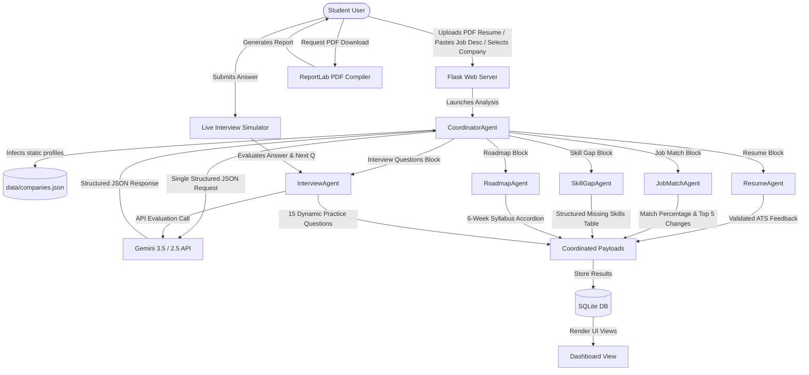

# AI Campus Placement Agent

# This project is a part of Nexus Spring of Code (NSoC) 2026 - Winter Edition
> 
[](https://opensource.org/licenses/MIT)
[](https://github.com/deepikagandla74/ai-campus-placement-agent)
[](CONTRIBUTING.md)

An AI-powered multi-agent assistant that helps students prepare for campus placements through resume analysis, job matching, personalized learning roadmaps, skill gap analysis, and interactive mock interviews.

This is an independently developed open-source application.

---

## Why is this an AI Agent System (and NOT a Chatbot)?

A typical chatbot operates as a single-turn or multi-turn conversational loop, where a single large language model (LLM) responds directly to user queries. 

In contrast, the **AI Campus Placement Agent** implements a **Coordinated Multi-Agent Architecture**:
1. **Orchestrated Workflow**: A single, central `CoordinatorAgent` receives the initial workspace context (resume, target job description, target company profiles).
2. **Task Delegation**: The coordinator executes a single structured LLM call to save token costs and prevent rate-limiting, and then delegates the resulting data subsets to specialized sub-agents.
3. **Dedicated Domain Responsibilities**: Each specialized agent is modeled as an independent Python class focusing on a single task:
   * **ResumeAgent**: Evaluates ATS formatting, experiences, strengths, and suggests grammar improvements.
   * **JobMatchAgent**: Performs keyword extraction and evaluates match percentages against the target role.
   * **SkillGapAgent**: Maps missing skills into an actionable table showing learning times, importance, and priority.
   * **RoadmapAgent**: Generates a custom 6-week curriculum with topic deep-dives and estimated study hours.
   * **InterviewAgent**: Generates tailored interview questions and handles dynamic, real-time responses scoring technical accuracy and communication.

---

## System Architecture & Workflow



---

## Features

1. **Resume Analysis & ATS Scoring**: Extract text from PDF resumes, run grammar & style checks, identify weaknesses, and calculate a grounded ATS Score.
2. **Job Description Matching**: Paste a Job Description to compare candidate metrics against corporate requirements, listing the exact changes needed to pass initial screenings.
3. **Skill Gap Remediation Table**: Get a prioritizing list of missing skills detailing estimated learning times, resource links, and custom project suggestions.
4. **6-Week Study Roadmap**: Access a weekly preparation calendar mapping theoretical topics, coding challenges, and revision items.
5. **Interactive Mock Interview Simulator**: Engage in a live, conversational chat with the Interview Agent. Answers are evaluated dynamically on technical accuracy, communication style, and confidence indicators.
6. **Static Company Profiles**: Contains pre-cached interview processes, hiring guidelines, eligibility patterns, and preparation advice for 15 top campus recruiters: Google, Microsoft, Amazon, Adobe, Flipkart, Zoho, TCS, Infosys, Accenture, Capgemini, Wipro, Cognizant, Deloitte, HCLTech, and Tech Mahindra.
7. **Comprehensive PDF Reports**: Generates and compiles a formatted, multi-page PDF document summarizing placement analysis and roadmaps using ReportLab.
8. **Dark / Light Theme Toggle**: Seamless single-click switching between light and dark modes with zero page reload, browser persistence (`localStorage`), default system preference detection (`prefers-color-scheme`), and high-contrast readability across dashboards, tables, interview chat, and study roadmaps.
9. **Placement Analysis History & Data Management**: Browse past evaluations ordered newest first, view target company, target role, and ATS scores, reopen past analyses in the dashboard view without running new AI calls, and delete stored analyses and personal data with confirmation.
10. **Privacy Notice & Consent Protection**: Transparent plain-language privacy notice (`/privacy`), required candidate consent before processing resume text via the Gemini API, optional PII redaction (masking emails, phones, and addresses), local SQLite storage, and complete account deletion options.

---

## Tech Stack

* **Frontend**: HTML5, CSS3, JavaScript, Bootstrap 5 (Material/Glassmorphism theme)
* **Backend**: Python, Flask, SQLite (for persistence of analyses & interview sessions)
* **AI Core**: Google Gen AI Python SDK (`google-genai`), Gemini API (Central model selection: `gemini-2.5-flash`)
* **Utilities**: PyPDF2 (PDF parsing), ReportLab (PDF compiling), python-dotenv (environment variables)

---

## Folder Structure

```
AI-Campus-Placement-Agent/
│   app.py                  # Flask Application Server
│   config.py               # Path configurations & Model settings
│   prompts.py              # Central prompt registry
│   requirements.txt        # Project dependencies
│   .env                    # Environment key file (GitIgnored)
│   README.md               # Project documentation
│
├───agents/                 # Independent AI Agent classes
│       coordinator.py
│       resume_agent.py
│       job_match_agent.py
│       skill_gap_agent.py
│       roadmap_agent.py
│       interview_agent.py
│
├───data/                   # Pre-cached static profile files
│       companies.json
│
├───static/                 # Styles and JS scripts
│   ├───css/
│   │       style.css
│   └───js/
│           script.js
│
├───templates/              # HTML layout templates
│       index.html
│       dashboard.html
│       interview.html
│
├───utils/                  # Backend support utilities
│       database.py
│       gemini.py
│       pdf_reader.py
│       report_generator.py
│
├───uploads/                # Uploaded resumes (Created on runtime)
└───reports/                # Generated report PDFs (Created on runtime)
```

---

## Installation & Setup

### 1. Clone the repository
```bash
git clone https://github.com/deepikagandla74/ai-campus-placement-agent.git
cd ai-campus-placement-agent
```

### 2. Configure Environment Variables
Create a `.env` file in the root folder:
```env
FLASK_SECRET_KEY=your_generated_random_secret
GEMINI_API_KEY=YOUR_GEMINI_API_KEY_HERE
```
> **Note:** Generate your Gemini API Key from Google AI Studio.

### 3. Install Dependencies
Ensure you have Python 3.9+ installed, then run:
```bash
pip install -r requirements.txt
```

### 4. Start the Application
Launch the Flask development server:
```bash
python app.py
```
The application will be running at `http://127.0.0.1:5000/`. Open this link in your browser to start.

---

## Rate Limiting & Security Quotas

To protect quota-limited AI endpoints (Gemini API calls) from accidental exhaustion or abuse, the application includes a sliding-window in-memory rate limiter with configurable thresholds.

### Endpoint Quotas

| Endpoint / Scope | Default Limit | Purpose |
|------------------|---------------|---------|
| `/analyze` & `/api/analysis/start` (`analyze`) | `5/hour` | Resume extraction and multi-agent coordination |
| `/interview/.../submit` (`interview_eval`) | `30/hour` | Dynamic mock interview evaluations |
| `/api/interview/evaluate-star` (`star_eval`) | `30/hour` | STAR behavioral response evaluation |
| `/batch-compare` (`batch_compare`) | `10/hour` | Concurrent multi-company placement evaluation |
| `/api/generate-outreach` (`generate_outreach`) | `20/hour` | Personalized cover letter & email generation |
| Default / Other Routes (`default`) | `100/minute` | General API and UI browsing |

### Throttling Behavior

- **HTTP Status 429**: When a user or client exceeds the allowed quota, the server returns an `HTTP 429 Too Many Requests` status code with `Retry-After`, `X-RateLimit-Limit`, and `X-RateLimit-Remaining: 0` headers.
- **Friendly UI & Hints**: Browser submissions render a dedicated `429.html` cooldown page displaying a clear explanation and dynamic "try again in X minutes" (or seconds) hint with a real-time countdown.
- **JSON API Responses**: REST/AJAX endpoints return a structured JSON response:
  ```json
  {
    "success": false,
    "error": "Too Many Requests",
    "message": "You have temporarily exceeded the request rate limit for this action. Please try again in 59 minutes.",
    "retry_after_seconds": 3540,
    "retry_after_hint": "try again in 59 minutes"
  }
  ```

### Configuration (Without Modifying Route Code)

Quotas can be adjusted centrally via `.env` or in `config.py` using standard `<count>/<unit>` format strings (`second`, `minute`, `hour`, `day`):

```env
# Enable or disable rate limiting globally (true / false)
RATE_LIMIT_ENABLED=true

# Custom quotas
RATE_LIMIT_ANALYZE=5/hour
RATE_LIMIT_INTERVIEW=30/hour
RATE_LIMIT_BATCH=10/hour
RATE_LIMIT_OUTREACH=20/hour
RATE_LIMIT_STAR=30/hour
RATE_LIMIT_DEFAULT=100/minute
```

---

## Resume Upload Validation & File Size Limits

To prevent application crashes, denial-of-service, slow requests, and confusing errors from malicious or malformed uploads, strict server-side validation is enforced in `app.py` and `utils/pdf_reader.py` before any parsing occurs:

- **True Content-Type & Signature Verification**: Uploaded files must match allowed extensions (`.pdf`, `.docx`) and pass byte-level magic signature checks (e.g. `%PDF-` signature for PDF documents and `PK\x03\x04` for Word documents). Renamed non-PDF files, fake documents, executables, or images are rejected immediately with user-friendly alerts.
- **Configurable File Size Boundary**: Uploads exceeding the maximum allowed size (default: **5 MB**) are stopped before saving to disk or calling parsers.
- **Graceful Error Recovery**: Rejection triggers readable UI notifications and HTTP 400 Bad Request responses instead of unhandled 500 internal server errors or raw stack traces.

### Configuration
```env
# Maximum allowed resume upload file size in megabytes (default: 5 MB)
MAX_UPLOAD_SIZE_MB=5
## Scanned & Image-Only PDF Detection

To prevent wasted AI quota and misleading evaluations from non-extractable resumes, `utils/pdf_reader.py` detects scanned or image-only PDF documents:

- **Early Halting & Quota Protection**: When an uploaded PDF yields empty text or fewer than the required characters (default: 100 characters), the analysis stops immediately before calling any Gemini LLM endpoints.
- **Actionable User Guidance**: Displays a clear notification informing the user that the document appears scanned or image-based, prompting them to upload a text-based PDF or paste resume text directly.
- **Configurable Thresholds**:
  ```env
  # Minimum extractable text characters required from a PDF resume (default: 100)
  MIN_PDF_TEXT_CHARS=100

  # Optional local OCR fallback (pytesseract). Disabled by default to avoid external dependencies.
  ENABLE_OCR_FALLBACK=false
  ```
## Gemini API Retry & Resilience

To prevent transient network glitches, 429 rate limits, and temporary 5xx server errors from failing an ongoing analysis or interview session, all outbound Gemini LLM calls in `utils/gemini.py` are protected with an automatic exponential backoff retry mechanism.

### Key Capabilities
- **Automatic Retry on Transient Errors**: Automatically retries HTTP 429 (rate limits/quota exhaustion), HTTP 500/502/503/504 (server overload/downtime), and socket/connection timeouts.
- **Fail Fast on Permanent Errors**: Non-transient errors such as HTTP 400 (bad requests), HTTP 401/403 (invalid API key or permissions), and formatting failures fail immediately without waiting or retrying.
- **Exponential Backoff with Full Jitter**: Delays scale progressively (e.g., 1s, 2s, 4s) up to a configurable maximum cap, with randomized jitter to prevent thundering herd spikes.
- **Friendly Error Messages**: When all retries are exhausted, the server logs the full error server-side and surfaces a clean, friendly message to the student (e.g., *"The AI service is busy, please try again in a minute."*). Raw tracebacks and API internals are never exposed to the user.

### Retry Configuration

Retry attempts and backoff intervals can be tuned in `config.py` or `.env`:

```env
# Maximum retry attempts before giving up (default: 3)
GEMINI_RETRY_ATTEMPTS=3

# Initial delay in seconds before the first retry (default: 1.0)
GEMINI_RETRY_INITIAL_DELAY=1.0

# Multiplier for subsequent backoff intervals (default: 2.0 -> 1s, 2s, 4s)
GEMINI_RETRY_BACKOFF_FACTOR=2.0

# Maximum upper bound delay cap in seconds (default: 10.0)
GEMINI_RETRY_MAX_DELAY=10.0

# Enable randomized jitter to avoid synchronized bursts (default: true)
GEMINI_RETRY_JITTER=true
```

---

## CSRF Protection & Session Cookie Security (#300)

To safeguard student accounts, mock interview sessions, and personal career preparation records against Cross-Site Request Forgery (CSRF) and unauthorized cross-origin requests, state-changing HTTP endpoints require a per-session verification token:

### Key Capabilities
- **Per-Session CSRF Verification**: All state-changing requests (`POST`, `PUT`, `DELETE`, `PATCH`) must provide a valid CSRF token, either via the `X-CSRFToken` / `X-CSRF-Token` HTTP headers or as a `csrf_token` hidden form parameter.
- **Frontend Interceptor**: A global `fetch()` wrapper in `static/js/script.js` extracts the session token from `<meta name="csrf-token">` and automatically injects it into all AJAX / fetch requests.
- **Actionable 400 Error Handling**: Requests lacking a valid token are rejected with HTTP 400. Browser requests display a styled, informative `templates/csrf_error.html` page with clear instructions to refresh, while AJAX / API requests receive a structured JSON 400 response.
- **Hardened Session Cookies**:
  - `SESSION_COOKIE_HTTPONLY=True`: Protects session cookies from cross-site scripting (XSS) client-side reads.
  - `SESSION_COOKIE_SAMESITE="Lax"`: Restricts cross-site cookie transmission to mitigate CSRF attacks.
  - `SESSION_COOKIE_SECURE`: Automatically set to `True` when running in production (`FLASK_ENV=production` or `SESSION_COOKIE_SECURE=true`), ensuring session cookies are only transmitted over HTTPS.

### Configuration
```env
# Enable or disable CSRF protection (default: true)
WTF_CSRF_ENABLED=true

# CSRF token expiration in seconds (default: 3600 = 1 hour)
WTF_CSRF_TIME_LIMIT=3600

# Session cookie SameSite policy (default: Lax)
SESSION_COOKIE_SAMESITE=Lax

# Force secure cookies regardless of environment (default: auto-detected from FLASK_ENV)
SESSION_COOKIE_SECURE=false
```

---

## Future Scope

The following features are being considered:
* **GitHub Profile Analyzer**: Scrape repositories to grade coding quality and contribution frequency.
* **LinkedIn Profile Review**: Sync profile sections to suggest bio keywords and networking adjustments.
* **Voice Mock Interviews**: Support voice-to-text and speech analysis to grade interview tone and pace.
* **Resume Version Comparison**: Compare formatting changes across iterations to track improvement.
* **LeetCode Progress Tracking**: Import solved problem counts and display targeted coding challenges.
* **Recruiter Email Generator**: Compose cold outreach emails tailored to hiring managers.
* **Placement Calendar Integration**: Log preparation milestones directly to Google Calendar.
* **Internship Recommendation Agent**: Suggest live job posts matching analyzed skill sets.

---

## Project Status

- ✅ **Multi-Agent Architecture**: Coordinated agent system with specialized sub-agents
- ✅ **Web Interface**: Responsive Flask-based UI with Bootstrap 5
- ✅ **Resume Analysis**: ATS scoring, grammar checks, and improvement suggestions
- ✅ **Job Matching**: Keyword extraction and match percentage calculation
- ✅ **Skill Gap Analysis**: Prioritized learning paths with time estimates
- ✅ **Study Roadmaps**: 6-week customized curriculum generation
- ✅ **Mock Interviews**: Interactive interview simulator with real-time evaluation
- ✅ **PDF Reports**: Comprehensive placement readiness reports
- ✅ **CI/CD Pipeline**: GitHub Actions for automated testing and validation

---

## Privacy & Data Protection

The AI Campus Placement Agent is committed to transparent, student-friendly data practices:
* **Plain-Language Privacy Notice**: Available at [`/privacy`](templates/privacy.html) (and linked in the application footer and upload form), detailing what data is collected, where it is sent, how long it is kept, and how to delete it.
* **Mandatory AI Processing Consent**: Every resume upload requires explicit consent before any resume text is submitted to third-party AI models.
* **Third-Party AI Service**: Resume text and target role details are sent securely over HTTPS to the Google Gemini API (`gemini-1.5-flash`) solely for immediate placement evaluation and roadmap generation.
* **Optional PII Redaction**: Students can toggle automated PII masking on the upload form to strip emails, phone numbers, addresses, and government IDs prior to transmission.
* **Local Storage & Retention**: Generated analyses, ATS scores, and interview records are stored in the host's local SQLite database (`data/campus_agent.db`). Uploaded files in `uploads/` are temporary.
* **Data Erasure & Control**: Candidates can permanently delete individual past analyses on the [History](/history) page or trigger complete profile erasure via [Delete Account](/delete-account).

---

## Contributing

We welcome contributions! Please see [CONTRIBUTING.md](CONTRIBUTING.md) for guidelines.

### Quick Start for Contributors

1. Fork the repository
2. Create a feature branch (`git checkout -b feature/amazing-feature`)
3. Commit your changes (`git commit -m 'Add amazing feature'`)
4. Push to the branch (`git push origin feature/amazing-feature`)
5. Open a Pull Request

---

## Community & Support

- 🆘 [Support Guide](SUPPORT.md) - Get help and common solutions
- 🐛 [Issue Tracker](https://github.com/deepikagandla74/ai-campus-placement-agent/issues)

---

## License

This project is licensed under the MIT License - see the [LICENSE](LICENSE) file for details.

---
<div align='center'>
  
### If you find this repo helpful, please consider giving it a ⭐ star on GitHub!

</div>
